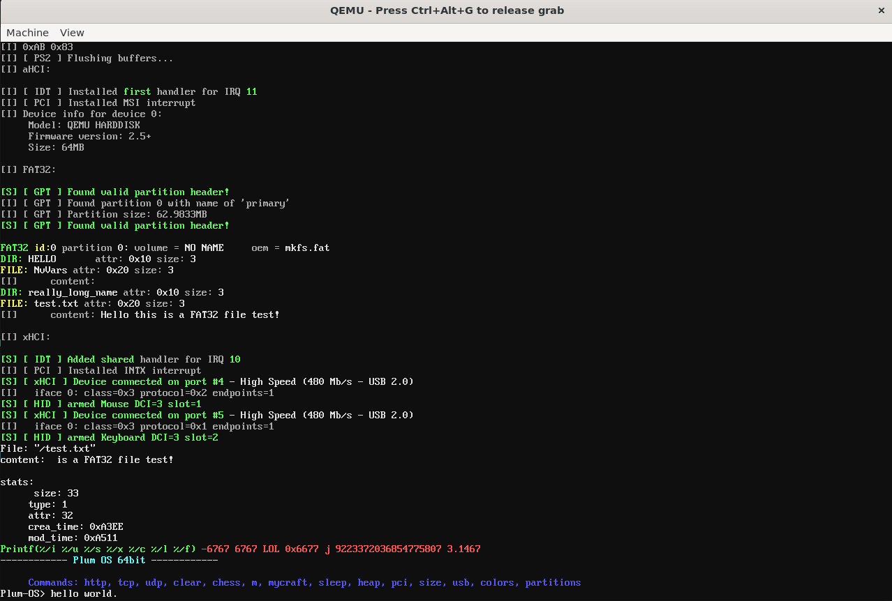
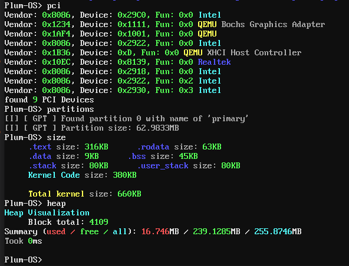
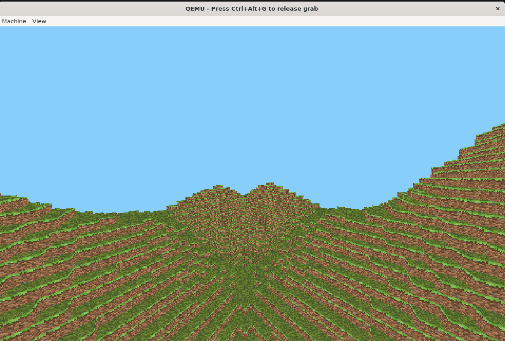
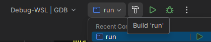

# Plum-OS
[](https://github.com/PLSiorbpl/PLum-OS/stargazers)
[](https://github.com/PLSiorbpl/PLum-OS/network/members)
[](https://github.com/PLSiorbpl/PLum-OS/issues)
[](https://github.com/PLSiorbpl/PLum-OS/blob/main/LICENSE)
[](https://github.com/PLSiorbpl/PLum-OS/commits)
[](https://github.com/PLSiorbpl/PLum-OS/releases)   


- Very basic 64bit UEFI kernel made by PLSiorbpl and Imated in **C++**
- _**Should**_ work on all modern and older Computers supporting UEFI
- Boots in **UEFI** **(be careful on real machine)**

## Structure
! not up-to-date !
```bash
Plum-OS/
├── src/      # Kernel Source code
│   ├── arch/       # All arch dependent stuff
│   │   └── x86/
│   │
│   ├── Drivers/    # Drivers (xHCI, aHCI, GPU, ATA)
│   ├── kernel/     # kernel systems
│   ├── libs/       # Libraries
│   │   └── std/    # Standard library (std)
│   ├── kernel.cpp/ # Kernel start
│   └── kernel.h 
│
├── CMakeLists.txt    # Build UEFI kernel and runs it in QEMU
└── Linker.ld   # Linker script
```

### Commands
- help
- clear
- poweroff (QEMU only)
- sleep
- heap
- pci
- size
- usb
- colors
- 

### Gaming?
- You are able to make games in this OS with linux-like syscalls and custom Standard Library
- What about 2d/3d? We have OpenGL like Driver "OpenPL" that is software rasterizer with vertex/fragment shaders
- example: MyCraft 

## Building
Using CMake:
```bash
> mkdir build/
> cd build/
> cmake ..
> make run    # Automatically runs qemu (VM) and build ISO

# Alternative: Make only needed Kernel.elf and BOOTX64.EFI
> make build
```
Or just click 'Build' button in your IDE with 'run' target selected. It will compile and run qemu
